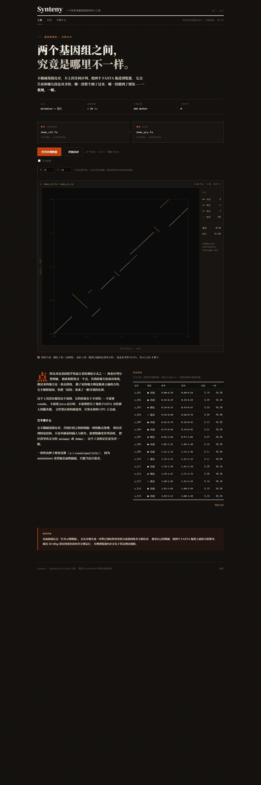

# Synteny

在浏览器里比较两个基因组的共线性。把两个 FASTA 拖进网页，立刻得到一张点阵图：
主对角线是保守的共线区段，斜率为负的那一段是倒位，离开主轴的独立方块是易位。

所有计算都在你自己的浏览器里完成——序列不会上传到任何服务器，页面加载后断网也能用。

**在线使用：<https://haomiaoyan.github.io/synteny/>**



## 为什么要看图

组装结果、近缘物种的染色体、同一个物种的两个版本，它们之间的关系通常用一句话讲不清：
哪里同源、哪里翻转过、哪里整段搬走了。点阵图把这些一次性摊开——横轴是一条基因组的坐标，
纵轴是另一条的，每一点代表一处匹配。

现有的点阵图工具大多是桌面程序或命令行（需要 JVM、需要装依赖、需要写参数）。
想快速看一眼两条序列的关系时，这些成本都不划算。这个工具用一次点击替代它们。

## 怎么看

| 图形 | 含义 |
| --- | --- |
| 沿主对角线的一串点 | 共线（col）——顺序和方向都一致 |
| 斜率为负的一段 | 倒位（inv）——同一段序列反向了 |
| 离开主轴、斜率为正的方块 | 易位（trn）——一段序列搬到了别处 |
| 零散暗点 | 噪声——属于任何区段之外的零散匹配，多为重复序列 |

右侧「区段」面板给出各类计数与覆盖比例；下方表格逐个列出区段，含长度与一致性估计。

## 交互

- **悬停**：读出光标处的 ref / qry 坐标
- **滚轮**：以光标为中心缩放；坐标轴单位会在 Mbp / kbp / bp 之间自动切换
- **拖框**：放大到框选的区域
- **双击**（或点右上角的倍率）：回到完整视图
- **点区块 / 点表格行**：两者互相高亮，选中区段在图中被框出
- **Esc**：取消选中；再按一次复位缩放
- **导出 CSV**：区段表可以直接喂给下游脚本

## 算法

1. **取样**：对两条序列各取 minimiser 种子（k-mer 长度 `k`，窗口 `w`）。相比逐个 k-mer，
   这样能把种子数压到约 2/w，同时保证不漏掉任何 k-mer 窗口。
2. **索引**：参考序列的种子用 FNV-1a 哈希，按 (hash, position) 做基数排序，之后二分查找。
3. **查找**：查询序列的种子同时查正链与反向互补链；命中数超过上限的种子按重复序列丢弃。
4. **链化**：正链种子按对角偏移 `d = r - q` 分组，负链按 `d = r + q` 分组；
   同组内按查询坐标排序后连成链，允许一定间隙。
5. **分类**：落在负链的链判为倒位；正链中偏移与主对角显著不同的判为易位；其余为共线。
6. **一致性**：由种子密度反推（`pow(覆盖率, 1/k)`），**不是**碱基级比对的结果，
   因此只能当粗略参考，见下方限制。

## 参数

| 参数 | 含义 | 建议 |
| --- | --- | --- |
| `k` | k-mer 长度。越大越严格，重复序列造成的假匹配越少 | 近缘物种 13–15，跨物种 17–19 |
| `w` | minimiser 窗口。越大种子越稀、越快 | 默认 24 |

留空（或不开「手动调参」）时按序列长度自动选择。

## 实测

以下数字来自本机的自动化测试，不是估计值：

| 场景 | 结果 |
| --- | --- |
| 示例数据（2.13 Mbp × 2.25 Mbp，含 3 处倒位、2 处易位、1 段重复） | 15 个区段（9 共线 / 3 倒位 / 3 易位），覆盖 95.0%，61,326 个种子，0.16 s |
| 上传真实 FASTA（含倒位与易位的合成基因） | 5 个区段（3 共线 / 1 倒位 / 1 易位），覆盖 97.6% |
| 序列与自身比较 | 1 个区段，覆盖 100% |
| 两条完全无关的序列 | 0 个区段，并提示「可能没有同源关系」 |
| `.gz` 压缩的 FASTA | 直接可用，结果与解压后一致 |

## 开发

需要 Node 20 以上。

```bash
npm install
npm run dev      # 开发服务器
npm test         # 29 个单元测试
npm run build    # 产出 dist/，纯静态
```

`dist/` 可以放在任何静态托管上；构建使用相对路径，因此放在子目录（例如 GitHub Pages 项目站点）也能直接用。

### 测试

- `tests/core.test.ts`、`tests/engine.test.ts`：引擎的单元测试，覆盖哈希、链化、分类、
  FASTA 解析与边界情况。
- `tools/*.mjs`：通过 Chrome DevTools Protocol 驱动的浏览器测试，覆盖悬停读数、拖框缩放、
  键盘操作、CSV 导出、文件上传与 gzip 解压等只能在实际浏览器里验证的行为。
  需要本机安装 Chrome。

## 目录

```
src/core/     引擎：哈希、种子、索引、链化、分类、FASTA 解析
src/ui/       渲染（canvas）与 Web Worker
src/main.ts   页面控制器
tests/        单元测试
tools/        浏览器测试与截图脚本
```

## 已知限制

- 每个文件只用**第一条**序列；多记录文件会在界面上明确提示，而不是把多条染色体拼成一条。
- 适合 MB 级基因组。更大的输入受浏览器内存限制。
- 一致性是由种子密度反推的估计值，不是碱基级比对；不统计 gap，也不做碱基质量评估。
- 只处理 FASTA，不读 BAM / MAF / VCF，不做多序列比对。
- 高度重复的序列（着丝粒、串联重复）会被种子上限压制，那部分结构看不到。

## 许可

MIT，见 [LICENSE](LICENSE)。
